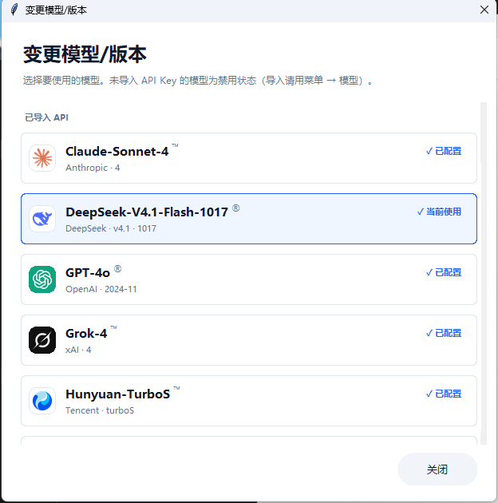
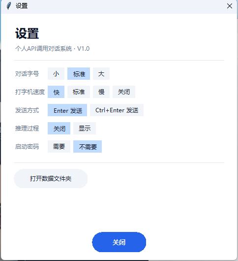
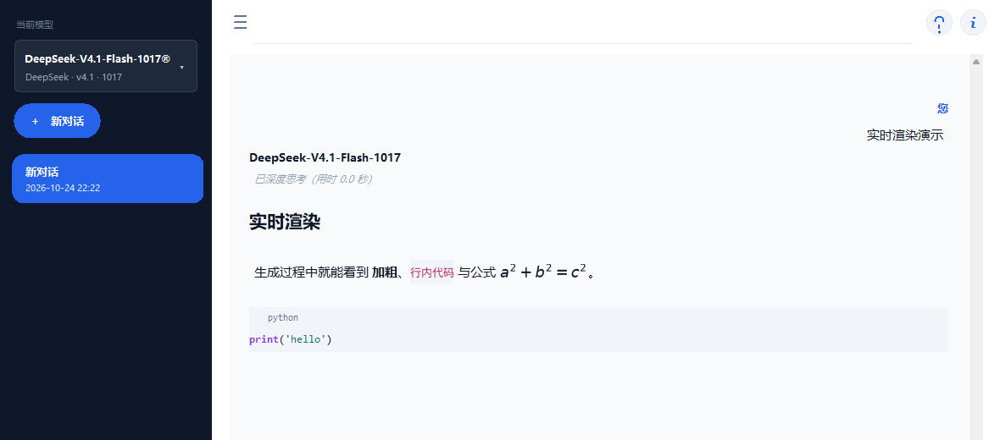

# 个人API调用对话系统 · Personal API Chat Client

一个**单文件**的 Windows 桌面 AI 对话客户端，用 Python + Tkinter 写成。
兼容所有 OpenAI 接口协议的模型服务，内置 37 个模型 / 32 个品牌，支持一键切换、独立密钥、推理可视化、实时 Markdown 渲染与对话级用量计费。

> Personal API Chat Client — a single-file Tkinter desktop chat client for any OpenAI-compatible API.
> 37 built-in models across 32 brands, per-model encrypted keys, streaming Markdown, math rendering, and per-conversation token/cost tracking.



---

## 目录

- [功能特性](#功能特性)
- [界面预览](#界面预览)
- [内置模型](#内置模型)
- [快速开始](#快速开始)
- [数据与隐私](#数据与隐私)
- [自行打包](#自行打包)
- [项目结构](#项目结构)
- [常见问题](#常见问题)
- [参与贡献](#参与贡献)
- [支持本项目](#支持本项目)
- [许可证与声明](#许可证与声明)

---

## 功能特性

**对话与模型**
- 37 个内置模型、32 个品牌，品牌徽标 + 型号展示，已导入的置顶、组内按字母排序
- 每个模型独立保存 API Key，界面只显示脱敏串；未导入的模型置灰
- 输入区上方可切换「深度思考」「智能搜索」，按模型能力自动显示
- 支持任意 OpenAI 兼容端点（改一行注册表即可接入自己的模型）

**显示与渲染**
- 流式生成时**按行实时渲染 Markdown**（标题、列表、引用、代码块、加粗、行内代码）
- LaTeX 数学公式与 `\ce{}` 化学式：优先 matplotlib 排版图，失败自动降级 Unicode
- 推理过程可视化：生成中实时显示，完成后折叠为 `▼ 已深度思考（用时 X 秒）`，点击展开
- 代码块语法高亮、复制、重新生成、对话导出 TXT

**账户与用量**
- PBKDF2-HMAC-SHA256（20 万次迭代）+ HMAC 认证流加密本地密钥库
- 启动密码可在设置中关闭（关闭后启动直接进入）
- **对话级 token 用量与费用**：按内置参考单价折算（非官方账单），两位小数 + K/M 单位
- DeepSeek 余额查询（对话里问「余额」即可）

**其他**
- 深色 UI、可调字号 / 打字机速度 / 发送方式
- 全中文界面 + 内置使用教程（右上角 `?`）
- 纯绿色便携：不写注册表、不写系统目录

## 界面预览

| 模型选择 | 设置 |
|---|---|
|  |  |

| 实时渲染 | 用量计费 |
|---|---|
|  |  |

## 内置模型

| 品牌 | 模型 |
|---|---|
| DeepSeek | V4.1-Flash-1017 / V4-Chat / R1-Reasoner |
| Alibaba | Qwen-Max / Qwen-Turbo |
| Moonshot | Kimi-K2 |
| Zhipu | GLM-4.6 / GLM-4-Flash |
| OpenAI | GPT-4o / GPT-4o-mini |
| Google | Gemini-2.0-Flash |
| ByteDance | Doubao-Seed-1.6 |
| xAI | Grok-4 |
| Mistral | Mistral-Large |
| Groq | Llama-3.3-70B |
| SiliconFlow | Qwen3-235B |
| MiniMax | MiniMax-M1 |
| Tencent | Hunyuan-TurboS |
| iFlytek | Spark-4.0 |
| OpenRouter | OpenRouter-Auto |
| Anthropic | Claude-Sonnet-4（经 OpenRouter） |
| Baidu | ERNIE-4.5 |
| 01.AI | Yi-Large |
| Baichuan | Baichuan4 |
| StepFun | Step-2 |
| SenseTime | SenseChat-5 |
| Perplexity | Sonar-Pro |
| Cohere | Command-R+ |
| AI21 | Jamba-Large |
| NVIDIA | Llama-3.3-Nemotron |
| Together | Qwen2.5-72B |
| Fireworks | DeepSeek-V3 |
| Cerebras / DeepInfra / HuggingFace | Llama-3.3-70B |
| Ollama / LM Studio | 本地模型（免密钥） |

> **关于模型名**：表中为应用内的**显示名**，实际请求的模型 ID 见 `MODEL_REGISTRY` 的 `api_model`。
> 显示名可自行修改；部分预置 ID 可能随服务商调整或需要你替换为自己账号可用的模型 ID。
>
> 名称与徽标仅用于标识对应服务，商标归各自所有者。见 [assets/logos/NOTICE.md](assets/logos/NOTICE.md)。

## 快速开始

### 方式一：下载发布版（推荐）

1. 到 [Releases](https://github.com/heibaiao/personal-api-chat-client/releases) 下载 `PersonalAPIChatClient-V1.0.1-portable-win64.zip`
2. 解压后双击 `PACC-V1.0.1.exe`（**不要**把 exe 单独拷走，它依赖同目录 `_internal`）
3. 首次启动：选择模型 → 填入该服务的 API Key → 设置本地密码

### 方式二：从源码运行

```bash
git clone https://github.com/heibaiao/personal-api-chat-client.git
cd personal-api-chat-client
pip install -r requirements.txt
python deepseek_chat.py
```

要求：Windows 10/11、Python 3.10+（开发环境 Python 3.15）、可用的 tkinter。

### 第一次使用

| 步骤 | 操作 |
|---|---|
| 1 | 弹窗里选模型（37 选 1），填入对应服务商的 Key |
| 2 | 设置至少 4 位的本地密码（用于加密 `config.enc`） |
| 3 | 在底部输入框提问，`Enter` 发送、`Shift+Enter` 换行 |
| 4 | 想免密码启动：菜单 → 设置 → 启动密码 → 不需要 |

## 数据与隐私

所有数据都在程序同目录，不上传任何服务器（除了你自己调用的模型 API）：

| 文件 | 内容 |
|---|---|
| `chat_history.json` | 全部对话记录 |
| `config.enc` | 加密后的多模型 API Key 库 |
| `settings.json` | 字号、打字速度、发送方式、推理过程、启动密码开关等 |
| `debug.log` | 运行日志 |

- 密钥永不以明文出现在界面或日志中
- 关闭启动密码后，`config.enc` 使用内置口令加密——**本机任何人都能直接使用**，请自行权衡
- 智能搜索会把检索词发往 DuckDuckGo

## 自行打包

Windows 上（需先 `pip install pyinstaller`）：

```bat
:: 目录版（推荐，稳定）
pyinstaller -D -w --name PACC-V1.0.1 --version-file version_info.txt ^
  --collect-all openai --collect-all httpx --collect-all httpcore --collect-all matplotlib ^
  --hidden-import matplotlib.backends.backend_agg ^
  --hidden-import matplotlib.mathtext ^
  --hidden-import matplotlib.font_manager deepseek_chat.py
```

产物在 `dist\PACC-V1.0.1\`，把 `assets\`（模型图标）复制进去即可。

`version_info.txt` 是 Windows 版本资源（发布者、产品名、版本号），可自行修改。
单文件版把 `-D` 换成 `-F`；注意单文件模式需要可写的临时目录，某些受限环境会解包失败，故默认推荐目录版。

## 项目结构

```
deepseek_chat.py       主程序（单文件，约 5.8k 行）
version_info.txt       Windows 版本资源
requirements.txt       Python 依赖
assets/logos/          模型品牌图标（<model_id>.png / <model_id>_dim.png）
docs/                  截图与发布说明
使用说明.txt            随发布包分发的用户说明
```

## 已知问题

以下限制在程序「关于页」有同步清单，后续版本逐步修复：

| 问题 | 说明 |
|---|---|
| 单文件版 | 受限环境可能解包失败，请使用目录版 |
| 复杂公式 | 矩阵 / cases / 含中文结构会降级为 Unicode 文本 |
| 实时渲染 | 未完成的最后一行需等换行才显示 |
| 用量与费用 | 服务商不返回 `usage` 时为估算值，费用仅供参考 |
| 价格表 | 内置单价为固定快照，官方调价后需手动更新 |
| 余额查询 | 仅 DeepSeek 提供公开余额接口 |
| 智能搜索 | 依赖 DuckDuckGo，可能被限流或取不到结果 |
| 推理显示 | 需服务商返回 `reasoning_content` 才有内容 |
| 关闭启动密码 | Key 等同本机可用，安全性下降 |
| 密码找回 | 无找回机制，只能删除 `config.enc` 重录 |
| 模型切换 | 生成回答期间不能切换模型 |
| 多开写入 | 同一目录多开会互相覆盖对话记录 |
| 平台支持 | 仅在 Windows 10/11 验证，未测 Linux / macOS |
| 上下文压缩 | 超过 20 轮自动摘要，早期细节可能丢失 |
| 网络代理 | 不支持程序内代理设置，需系统级代理 |

## 常见问题

**Q：为什么没有单文件版？**
单文件版需要把运行时解压到临时目录，部分受限/受管环境会失败（`Failed to create parent directory structure`）。目录版最稳，故作为默认发布形态。

**Q：公式显示成文字？**
超出 matplotlib mathtext 能力的公式（矩阵、含中文的复杂结构）会降级为 Unicode 文本，不会出现原始 LaTeX。

**Q：能接入自己的模型吗？**
可以。在 `MODEL_REGISTRY` 里加一条（id / name / vendor / base_url / api_model），再在 `MODEL_PRICING` 里补价格即可，无需改其它逻辑。

**Q：余额查询为什么只有 DeepSeek？**
目前只有 DeepSeek 提供公开的余额接口。

## 参与贡献

欢迎 Issue / PR，见 [CONTRIBUTING.md](CONTRIBUTING.md)。
提交前请确认没有把 `config.enc`、`chat_history.json`、`debug.log` 或个人 API Key 提交进去。

## 支持本项目

本项目由个人业余维护：代码免费、无广告、不收集任何数据。如果它帮到了你，可以自愿赞赏支持：

<p align="center">
  
</p>

**资金去向**：全部用于项目本身——模型 API 调用费用（接入新模型、回归测试）、打包与代码签名成本、图标与素材。

- **完全自愿**：赞赏不会解锁任何额外功能，也不影响正常使用
- 预算有限的学生，点个 ⭐、报个 Bug、帮忙测一个模型，同样是支持

## 许可证与声明

- 代码：[MIT License](LICENSE) © 2026 heibaiao
- **品牌图标不在 MIT 授权范围内**：`assets/logos/` 下的图片是各自所有者的商标，
  仅作指示性使用（标识对应服务），不构成任何授权；权利人可要求移除，见
  [assets/logos/NOTICE.md](assets/logos/NOTICE.md)
- 本项目与 DeepSeek、OpenAI、Alibaba、Google 等公司**无任何隶属关系**，也未获其背书
- 所有模型名称与商标归各自所有者，仅用于标识兼容的服务
- 使用第三方 API 产生的费用由使用者自行承担；程序内的单价为**参考快照**，可能与官方最新价目不同
- 本项目主要由deepseek harness进行编写，heibaiao进行创造推进。
